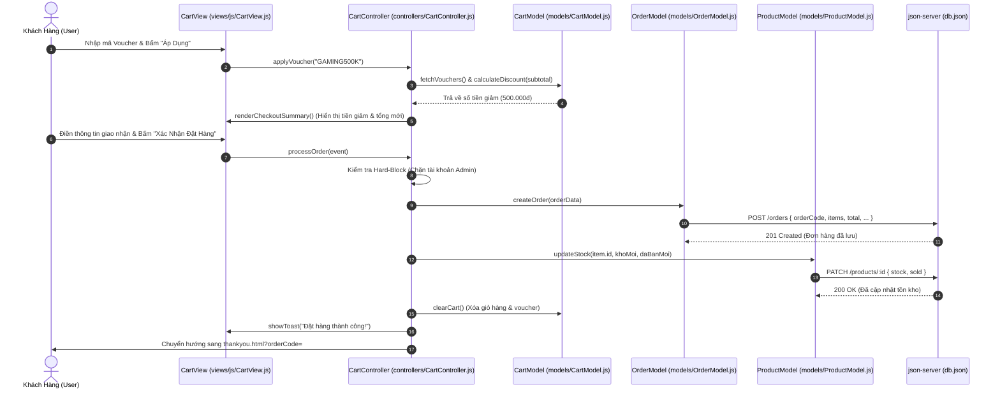

# SƠ ĐỒ VÀ TÀI LIỆU KIẾN TRÚC MÔ HÌNH CHUẨN MVC (MODEL - VIEW - CONTROLLER)
## DỰ ÁN: WEBSITE BÁN ĐIỆN THOẠI THÔNG MINH SMARTSTORE
**Môn học:** Lập trình JavaScript Nâng Cao (WEB2062 / Javascript Advanced) - FPT Polytechnic  
**Kiến trúc hệ thống:** Mô hình MVC Chuẩn (Model - View - Controller) ở cấp thư mục gốc (Root-Level MVC) kết hợp Cơ chế Đồng Bộ Kép (Dual-Entry Architecture) & CSS Phân Tầng Chuyên Biệt.

---

## 1. TỔNG QUAN KIẾN TRÚC HỆ THỐNG (SYSTEM OVERVIEW)

Dự án được tổ chức theo chuẩn mực kiến trúc MVC cấp thư mục gốc (Root-Level MVC Structure):
- 📁 **`models/`**: Tầng xử lý Dữ liệu, kết nối RESTful API `db.json` qua `json-server`, quản lý lưu trữ trạng thái `localStorage` và logic tính toán nghiệp vụ (tính voucher, tiến trình quà tặng, cập nhật tồn kho).
- 📁 **`views/`**: Tầng hiển thị Giao diện Người Dùng, chứa toàn bộ các trang HTML độc lập của dự án (`home.html`, `shop.html`, `detail.html`, `cart.html`, `checkout.html`, `thankyou.html`, `auth.html`, `profile.html`, `tracking.html`, `contact.html`, `admin.html`) cùng thư mục `views/js/` chứa các View Class chuyên trách render DOM.
- 📁 **`controllers/`**: Tầng Điều phối và Xử lý Sự kiện, điều phối luồng dữ liệu hai chiều giữa Model và View, xử lý router thông minh, bắt các sự kiện submit form, click nút và áp dụng phân quyền hệ thống.

```
                          ┌───────────────────────────┐
                          │   NGƯỜI DÙNG (USER/CLIENT)│
                          └─────────────┬─────────────┘
                                        │ (Tương tác: Click, Submit, Search)
                                        ▼
    ┌───────────────────────────────────────────────────────────────────────┐
    │                CONTROLLER LAYER (THƯ MỤC /controllers/)               │
    │  • AppController.js      : Dual-Mode Router, Khởi tạo ứng dụng        │
    │  • ShopController.js     : Lọc hãng, tìm kiếm, sắp xếp, so sánh       │
    │  • DetailController.js   : Xem 10 thông số, tăng giảm số lượng, mua ngay│
    │  • CartController.js     : Thêm/Sửa/Xóa giỏ, Voucher, Thanh toán, Hóa đơn│
    │  • AuthController.js     : Đăng nhập/ký, Hồ sơ, Hủy đơn, Nhận diện danh tính│
    │  • mvc_app.js            : Bootstrap adapter, gắn global interfaces   │
    │  • admin/                : Bộ điều khiển quản trị viên (CRUD, Orders) │
    └──────────────────┬────────────────────────────────────┬───────────────┘
                       │                                    ▲
          (1) Thao tác │                                    │ (4) Kích hoạt
              dữ liệu  │                                    │     render
                       ▼                                    │
    ┌──────────────────────────────────────┐  (3) Dữ liệu   │
    │   MODEL LAYER (THƯ MỤC /models/)     ├────────────────┤
    │  • ProductModel.js : API /products   │    đã xử lý    │
    │  • CartModel.js    : localStorage    │                │
    │  • OrderModel.js   : API /orders     │                │
    │  • UserModel.js    : API /users      │                │
    └──────────────────┬───────────────────┘                │
                       │                                    │
          (2) Giao tiếp│ RESTful API                        │
              CRUD     ▼                                    │
    ┌──────────────────────────────────────┐                │
    │     BACKEND MOCK (JSON-SERVER)       │                │
    │             db.json                  │                │
    └──────────────────────────────────────┘                │
                                                            ▼
                                           ┌────────────────────────────────┐
                                           │    VIEW LAYER (THƯ MỤC /views/)│
                                           │  • Giao diện HTML độc lập:     │
                                           │    home, shop, detail, cart,   │
                                           │    checkout, thankyou, auth,   │
                                           │    profile, tracking, contact, │
                                           │    admin.html                  │
                                           │  • Renderers (views/js/):      │
                                           │    BaseView, ProductView,      │
                                           │    CartView, OrderView, UserView│
                                           └────────────────┬───────────────┘
                                                            │ (5) Cập nhật DOM
                                                            ▼
                                           ┌────────────────────────────────┐
                                           │     GIAO DIỆN NGƯỜI DÙNG (DOM) │
                                           │  (styles/base.css + user.css)  │
                                           └────────────────────────────────┘
```

---

## 2. SƠ ĐỒ LUỒNG DỮ LIỆU MERMAID (DATA FLOW SEQUENCE)

### Luồng Đặt Hàng & Áp Dụng Voucher (Voucher Engine & Checkout Flow)



---

## 3. BẢN ĐỒ CẤU TRÚC THƯ MỤC VÀ TỆP TIN DỰ ÁN

```
website-gaming-phone/
│
├── controllers/                   # 1. TẦNG CONTROLLER (ĐIỀU PHỐI LOGIC VÀ NGHIỆP VỤ)
│   ├── admin/                     # Bộ điều khiển quản trị viên
│   │   ├── customers.js           # Quản lý khách hàng, khóa/mở tài khoản
│   │   ├── main.js                # Khởi tạo Dashboard quản trị
│   │   ├── orders.js              # Duyệt đơn hàng (có xác nhận an toàn), in hóa đơn admin
│   │   ├── products.js            # CRUD sản phẩm, preview ảnh, xóa an toàn
│   │   └── state.js               # State admin, kiểm tra vai trò admin
│   ├── AppController.js           # Bộ điều khiển trung tâm, Router Dual-Mode SPA/MPA
│   ├── AuthController.js          # Xử lý Đăng nhập, Đăng ký, Hồ sơ, Khách hủy đơn hoàn kho
│   ├── CartController.js          # Thêm/sửa/xóa giỏ, Voucher, Đặt hàng (chặn admin), Hóa đơn
│   ├── DetailController.js        # Đọc ?id=..., nạp 10 thông số chuẩn CellphoneS, Mua Ngay
│   ├── ShopController.js          # Lọc 8 hãng, tìm kiếm, lọc giá, phân trang, so sánh
│   └── mvc_app.js                 # Bootstrap ứng dụng, adapter backward compatibility
│
├── models/                        # 2. TẦNG MODEL (DỮ LIỆU, LOCALSTORAGE & API SERVER)
│   ├── CartModel.js               # Quản lý smartstore_cart, tính tổng, voucher, quà tặng
│   ├── OrderModel.js              # Giao tiếp API /orders, tạo đơn, tra cứu, hủy đơn hoàn tồn kho
│   ├── ProductModel.js            # Giao tiếp API /products, /categories, bộ lọc, so sánh
│   └── UserModel.js               # Quản lý smartstore_user, API /users, Smart Identity
│
├── views/                         # 3. TẦNG VIEW (GIAO DIỆN NGƯỜI DÙNG & DOM RENDERERS)
│   ├── js/                        # Bộ thư viện JavaScript chuyên trách Render DOM
│   │   ├── BaseView.js            # Toast thông báo, Modal mở/đóng an toàn, Định dạng tiền VND
│   │   ├── CartView.js            # Bảng giỏ hàng, Thanh quà tặng Gamification, Tóm tắt checkout
│   │   ├── OrderView.js           # Màn hình cảm ơn, Hóa đơn bán lẻ kiêm phiếu bảo hành, Lịch sử đơn
│   │   ├── ProductView.js         # Lưới sản phẩm, Phân trang, Chi tiết 10 thông số, Bảng so sánh
│   │   └── UserView.js            # Form auth, Form cập nhật hồ sơ, Thẻ Smart Identity Resolution
│   ├── admin.html                 # Giao diện Bảng Quản Trị Admin Dashboard
│   ├── auth.html                  # Giao diện Đăng Nhập & Đăng Ký Tài Khoản
│   ├── cart.html                  # Giao diện Giỏ Hàng & Thanh Quà Tặng Gamification Reward Bar
│   ├── checkout.html              # Giao diện Thanh Toán & Khối Voucher Chips
│   ├── contact.html               # Giao diện Giới Thiệu & Form Gửi Tin Nhắn Liên Hệ
│   ├── detail.html                # Giao diện Chi Tiết Sản Phẩm & Bảng 10 Thông Số Kỹ Thuật
│   ├── home.html                  # Giao diện Trang Chủ (Hero Banner 3D, Flash Sale, Top máy)
│   ├── profile.html               # Giao diện Hồ Sơ Cá Nhân & Bảng Đơn Hàng Đã Mua
│   ├── shop.html                  # Giao diện Cửa Hàng (Lọc 8 hãng, Tìm kiếm, Bảng so sánh)
│   ├── thankyou.html              # Giao diện Đặt Hàng Thành Công (Stepper, Hóa đơn, In ấn)
│   └── tracking.html              # Giao diện Tra Cứu Tiến Trình Vận Đơn Bằng Mã Đơn / SĐT
│
├── styles/                        # HỆ THỐNG CSS PHÂN TẦNG CHUYÊN BIỆT
│   ├── admin.css                  # Toàn bộ CSS giao diện quản trị viên Admin (Navbar, Sidebar, Tables)
│   ├── base.css                   # Biến màu (CSS Variables), Reset, Header, Footer, Nút bấm, Modal, Toast
│   ├── user.css                   # Toàn bộ CSS giao diện khách hàng (Cards, Filters, Detail, Cart, Print)
│   └── style.css                  # Master Bundle (@import base.css, user.css, admin.css) tương thích ngược
│
├── index.html                     # Điểm truy cập gốc (Cơ chế Dual-Entry hiển thị Trang Chủ & Gateway)
├── db.json                        # Cơ sở dữ liệu JSON-Server (products, categories, users, orders, vouchers)
├── chay_server.bat                # Script batch tự động giải phóng port 3000 và khởi động server an toàn
├── NGUYEN_TAC_BAO_TOAN...md       # Quy tắc bảo toàn tính năng chống hỏng chéo
└── GOP_Y_GIANG_VIEN...md          # Góp ý của giảng viên và chiến lược trả lời vấn đáp điểm 10
```

---

## 4. CHI TIẾT TỪNG TẦNG TRONG MÔ HÌNH MVC

### 4.1. Tầng Model (`models/`)
- **ProductModel.js**:
  - `fetchAllProducts()`: Gọi `GET /products` lấy 40 sản phẩm chính hãng.
  - `fetchCategories()`: Gọi `GET /categories` lấy 8 danh mục thương hiệu.
  - `fetchProductById(id)`: Lấy thông số chi tiết 1 sản phẩm.
  - `updateStock(id, newStock, newSold)`: Gọi `PATCH /products/:id` cập nhật kho và lượng đã bán.
  - `filterProducts(items, filters)`: Thuật toán lọc đa tiêu chí (Thương hiệu + Từ khóa + Khoảng giá + Sắp xếp).
  - `paginate(items, page, pageSize)`: Phân trang danh sách sản phẩm.
  - `addToCompare(id)`: Quản lý tối đa 3 máy so sánh trong `localStorage` (`smartstore_compare`).

- **CartModel.js**:
  - `getItems()`, `saveItems(items)`: Lưu trữ giỏ hàng trong `localStorage` (`smartstore_cart`).
  - `addItem(product, qty)`: Thêm sản phẩm, kiểm tra nghiêm ngặt tồn kho không cho vượt quá số lượng trong kho.
  - `changeQuantity(id, delta)`: Tăng giảm số lượng an toàn, tự động cảnh báo khi vượt tồn kho hoặc chạm mốc tối thiểu.
  - `calculateDiscount(subtotal)`: Thuật toán tính số tiền giảm giá đa điều kiện (theo số tiền cố định hoặc theo % có giới hạn `maxDiscount` và điều kiện `minOrder`).
  - `calculateRewardProgress(subtotal)`: Tính toán % tiến trình và mốc quà tặng Gamification Reward Bar (10 triệu: Củ sạc 67W, 20 triệu: Combo Gaming VIP).

- **OrderModel.js**:
  - `createOrder(orderData)`: Gọi `POST /orders` tạo đơn hàng mới.
  - `fetchOrderByCode(code)`: Tra cứu đơn hàng theo mã `#DH...` hoặc ID.
  - `fetchOrdersByUserId(userId)`: Lấy toàn bộ đơn hàng cá nhân của khách hàng.
  - `cancelOrder(orderId)`: Gọi `PATCH /orders/:id` chuyển trạng thái sang `cancelled`, đồng thời hoàn trả lại toàn bộ số lượng tồn kho cho các sản phẩm trong đơn.

- **UserModel.js**:
  - `getCurrentUser()`, `saveUser(user)`, `logout()`: Quản lý phiên làm việc trong `localStorage` (`smartstore_user`).
  - `login(email, password)`: Xác thực thông tin đăng nhập, phân loại vai trò `admin` hoặc `customer`.
  - `register(name, email, password, phone, address)`: Đăng ký tài khoản mới, kiểm tra chống trùng lặp email.
  - `checkIdentityByEmail(email)`: Tính năng Smart Identity Resolution nhận diện danh tính khi nhập email lúc thanh toán.

---

### 4.2. Tầng View (`views/` & `views/js/`)
- **Giao Diện HTML Độc Lập (`views/*.html`)**:
  - Mỗi tệp HTML đóng vai trò là một View hoàn chỉnh, độc lập, có thể mở trực tiếp hoặc điều hướng qua Router.
  - Liên kết CSS thông qua `../styles/base.css` và `../styles/user.css` (hoặc `../styles/admin.css`).
  - Nhập mã nguồn MVC thông qua `../models/`, `js/` (views), và `../controllers/`.
- **BaseView.js**:
  - `showToast(msg, type)`: Hiển thị thông báo trạng thái nổi góc dưới (`success`, `warning`, `error`, `info`).
  - `openModal(id)`, `closeModal(id)`: Quản lý bật/tắt modal an toàn, tự động khóa cuộn trang (`overflow: hidden`).
  - `formatCurrency(val)`: Chuyển đổi số thành tiền Việt Nam Đồng (ví dụ: `25.990.000 ₫`).
  - `renderNavUser(user)`: Hiển thị Avatar, tên người dùng, Menu Dropdown hồ sơ hoặc nút Đăng nhập.
- **ProductView.js**:
  - `createProductCardHtml(sp)`: Sinh thẻ sản phẩm chuẩn với Spec Chips (RAM, CPU, Pin), huy hiệu Sale/Hot, nút Xem nhanh, So sánh, Thêm giỏ.
  - `renderProductGrid(containerId, products)`: Hiển thị lưới thẻ sản phẩm.
  - `renderPagination(containerId, totalPages, currentPage)`: Hiển thị các nút phân trang (Trước, 1, 2, 3, Sau).
  - `renderProductDetail(containerId, sp)`: Hiển thị chi tiết sản phẩm kèm **Bảng 10 Thông Số Kỹ Thuật Chuẩn CellphoneS**.
  - `renderComparisonTable(containerId, products)`: Hiển thị bảng đối chiếu 10 thông số cạnh nhau giữa tối đa 3 mẫu điện thoại.
- **CartView.js**:
  - `renderCartTable(items, subtotal)`: Render bảng giỏ hàng với nút tăng giảm số lượng, thành tiền từng món.
  - `renderRewardBar(subtotal)`: Render thanh tiến trình quà tặng Gamification với hiệu ứng lấp đầy track màu xanh ngọc.
  - `renderCheckoutSummary(items, subtotal, discount, total, voucher)`: Render tóm tắt chi phí thanh toán.
  - `renderVoucherChips(vouchers, appliedVoucher, subtotal)`: Render danh sách mã giảm giá gợi ý để khách bấm chọn nhanh.
- **OrderView.js**:
  - `renderThankYouView(order)`: Render màn hình đặt hàng thành công kèm Stepper tiến trình 4 giai đoạn.
  - `renderInvoiceModal(modalBodyId, order)`: Render **Hóa Đơn Bán Hàng Kiêm Phiếu Bảo Hành** chuyên nghiệp đầy đủ Quốc hiệu, Mã số thuế, Chi tiết linh kiện, Cam kết bảo hành 12 tháng, Chữ ký xuất kho.
  - `renderUserOrders(containerId, orders)`: Render danh sách đơn hàng cá nhân trong trang Profile với nút Hủy đơn an toàn.
  - `renderTrackingResult(containerId, orders)`: Render kết quả tra cứu tiến trình đơn hàng.

---

### 4.3. Tầng Controller (`controllers/`)
- **AppController.js**:
  - Khởi tạo tất cả Models.
  - **Dual-Mode Router (`goTo(viewName, params)`)**: Tự động nhận diện xem URL đang ở thư mục `views/` hay ở root để sinh đường dẫn tương đối chuẩn xác (`prefix = inViews ? '' : 'views/'`), giúp chuyển trang mượt mà không bao giờ gặp lỗi 404.
  - Quản lý phím nóng toàn cục (`Escape` để đóng modal, click backdrop để đóng).
- **ShopController.js**:
  - Bắt các sự kiện thay đổi trên Form tìm kiếm, Dropdown lọc giá, Dropdown sắp xếp.
  - Điều phối thuật toán lọc của `ProductModel` và gọi `ProductView` cập nhật lại giao diện.
- **DetailController.js**:
  - Đọc `?id=...` từ URL query string.
  - Nạp thông tin sản phẩm và điều phối hiển thị chi tiết.
  - Xử lý hành vi nút **"Mua Ngay"** (Thêm vào giỏ và chuyển thẳng sang màn hình thanh toán Checkout).
- **CartController.js**:
  - Điều phối tăng/giảm số lượng món hàng, xóa sản phẩm, làm sạch giỏ.
  - Xử lý áp dụng voucher, kiểm tra điều kiện đơn tối thiểu.
  - **Xử lý Đặt hàng**: Thực hiện Hard-Block chặn tài khoản Admin mua hàng, sinh mã đơn `#DH...`, lưu đơn lên server, trừ tồn kho và chuyển hướng sang màn hình cảm ơn.
  - Xử lý mở modal xem hóa đơn và kích hoạt lệnh in trực tiếp `window.print()`.
  - Xử lý nút **"Xem Đơn Hàng Của Tôi"** với cơ chế phân luồng thông minh theo trạng thái phiên làm việc.
- **AuthController.js**:
  - Xử lý biểu mẫu Đăng nhập và Đăng ký tài khoản.
  - Xử lý Đăng xuất và dọn dẹp phiên.
  - Xử lý cập nhật thông tin cá nhân.
  - Xử lý sự kiện khách hàng hủy đơn hàng (kèm xác nhận bảo vệ và hoàn trả kho).
  - Xử lý tính năng Smart Identity Resolution (tự động nhận diện tài khoản khi nhập email tại bước thanh toán).

---

## 5. HƯỚNG DẪN BẢO VỆ ĐIỂM 10 TRƯỚC GIẢNG VIÊN (DEFENSE Q&A)

### Câu hỏi 1: "Em hãy trình bày cấu trúc thư mục dự án và giải thích tại sao dự án của em chuẩn mô hình MVC?"
> **Trả lời:**  
> "Thưa thầy/cô, toàn bộ dự án của em được tổ chức tường minh ngay tại thư mục gốc thành 3 trụ cột MVC chuẩn mực:  
> - **Thư mục `models/`**: Chuyên trách tầng Dữ liệu, trừu tượng hóa các thực thể `ProductModel`, `CartModel`, `OrderModel`, `UserModel`. Mọi thao tác đọc/ghi `localStorage` và gọi API `fetch()` lên `json-server` (`db.json`) đều được đóng gói độc lập tại đây, hoàn toàn không dính dáng đến giao diện.  
> - **Thư mục `views/`**: Chuyên trách tầng Giao diện, bao gồm đầy đủ các tệp giao diện HTML độc lập (`home.html`, `shop.html`, `cart.html`, `checkout.html`, `thankyou.html`, `auth.html`, `profile.html`, `tracking.html`, `contact.html`, `admin.html`) cùng thư mục `views/js/` chứa các View Class chuyên môn hóa render DOM.  
> - **Thư mục `controllers/`**: Chuyên trách tầng Điều phối, là cầu nối nhận lệnh từ người dùng (Event Listeners), gọi Model xử lý nghiệp vụ rồi lệnh cho View cập nhật giao diện.  
> Ngoài ra, hệ thống CSS được bóc tách riêng biệt trong `styles/` (`base.css`, `user.css`, `admin.css`) giúp giao diện không bị xung đột và tối ưu hóa hiệu năng tải trang."

### Câu hỏi 2: "Cơ chế Dual-Entry và Router của em hoạt động như thế nào khi người dùng truy cập từ file `index.html` ở gốc và các view con trong `views/`?"
> **Trả lời:**  
> "Thưa thầy/cô, để bảo đảm tính linh hoạt và bảo toàn tính năng tuyệt đối:  
> - File **`index.html`** ở thư mục gốc đóng vai trò là **Front Controller & Trang Chủ trực tiếp**. Khi chạy lệnh `chay_server.bat`, `json-server` tự động phục vụ `index.html` ngay lập tức mà không cần gõ đường dẫn dài.  
> - Khi người dùng bấm chuyển trang, hàm **`AppController.goTo(viewName, params)`** sử dụng thuật toán nhận diện ngữ cảnh URL: nếu đang ở trong `views/` thì chuyển hướng nội bộ (`shop.html`), nếu đang ở root thì tự động thêm tiền tố (`views/shop.html`).  
> - Các trạng thái phiên như Giỏ hàng (`smartstore_cart`) và Đăng nhập (`smartstore_user`) được lưu trong `localStorage`, còn tham số truyền trang (`?id=...`, `?orderCode=...`) được đọc qua `URLSearchParams`. Nhờ vậy, người dùng mở từ `index.html` hay mở trực tiếp bất kỳ tệp nào trong `views/` đều hoạt động trơn tru 100% không phát sinh lỗi 404 hay mất dữ liệu."

---
*Tài liệu được bảo chứng kỹ thuật cho kỳ thi Bảo vệ Assignment môn JavaScript Nâng Cao - FPT Polytechnic.*
