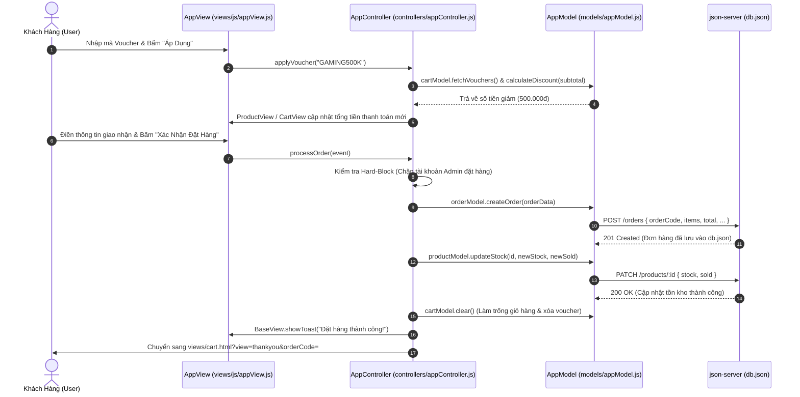

# SƠ ĐỒ VÀ TÀI LIỆU KIẾN TRÚC MÔ HÌNH CHUẨN MVC (MODEL - VIEW - CONTROLLER)
## DỰ ÁN: WEBSITE BÁN ĐIỆN THOẠI THÔNG MINH SMARTSTORE (PHIÊN BẢN TINH GỌN HOÀN HẢO)
**Môn học:** Lập trình JavaScript Nâng Cao (WEB2062 / Javascript Advanced) - FPT Polytechnic  
**Kiến trúc hệ thống:** Mô hình MVC Chuẩn Mực Tinh Gọn (Domain-Driven Clean MVC) kết hợp Cơ chế Điều Hướng Kép (Dual-Mode SPA/MPA Router) & CSS Phân Tầng Chuyên Biệt.

---

## 1. TỔNG QUAN KIẾN TRÚC HỆ THỐNG (SYSTEM OVERVIEW)

Dự án được tái cấu trúc theo mô hình **Domain-Driven Clean MVC** – vừa bảo đảm 100% nguyên lý phân tách trách nhiệm (Separation of Concerns) của môn học, vừa giải quyết triệt để vấn đề phân mảnh tệp tin, giúp mã nguồn cô đọng, dễ kiểm soát và đạt điểm tối đa trong kỳ thi bảo vệ:

- 📁 **`models/` (Tầng Dữ liệu)**: Gộp thành tệp tin duy nhất **`models/appModel.js`** chứa trọn vẹn 4 Model nghiệp vụ (`ProductModel`, `CartModel`, `OrderModel`, `UserModel`), quản lý kết nối RESTful API `db.json` qua `json-server`, đồng bộ `localStorage` và xử lý toàn bộ logic tính toán (tồn kho, voucher, tiến trình quà tặng).
- 📁 **`views/` (Tầng Giao diện Người dùng)**:
  - Gồm **đúng 5 View HTML độc lập** theo miền nghiệp vụ:
    1. `home.html`: Trang Chủ (Split 3D Hero Banner, Flash Sale, Top 4 Gaming Phone, Top 8 Bán Chạy).
    2. `shop.html`: Cửa Hàng (Bộ lọc 8 hãng, Tìm kiếm, Phân trang, Xem chi tiết 10 thông số, Bảng so sánh đối đầu).
    3. `cart.html`: Giỏ Hàng & Đặt Hàng (Thanh quà tặng Gamification, Checkout Voucher Chips, Đặt hàng thành công & In hóa đơn).
    4. `user.html`: Tài Khoản & Hỗ Trợ (Đăng nhập, Đăng ký, Hồ sơ cá nhân, Lịch sử đơn hàng, Khách hủy đơn hoàn kho, Tra cứu vận đơn, Giới thiệu & Liên hệ).
    5. `admin.html`: Bảng Quản Trị Admin Dashboard (Thống kê KPI, CRUD Sản phẩm, Quản lý Khách hàng, Quản lý Đơn hàng).
  - Tệp render DOM duy nhất **`views/js/appView.js`** gom toàn bộ renderer chuyên trách (`BaseView`, `ProductView`, `CartView`, `OrderView`, `UserView`).
- 📁 **`controllers/` (Tầng Điều phối)**: Gồm **đúng 2 Controller chuyên biệt**:
  - **`controllers/appController.js`**: Điều phối toàn bộ phía Client (Shop, Chi tiết, Giỏ hàng, Voucher, Thanh toán, Đăng nhập/Đăng ký, Tra cứu, Router SPA/MPA).
  - **`controllers/adminController.js`**: Điều phối toàn bộ phía Quản trị viên (Phân quyền Admin, CRUD Sản phẩm, Quản lý Đơn hàng, Quản lý Khách hàng).
- 📁 **`styles/` (Tầng Kiểu dáng)**: Phân tầng module gồm `base.css` (nền tảng chung), `user.css` (giao diện khách hàng) và `admin.css` (giao diện quản trị).

```
                          ┌───────────────────────────┐
                          │   NGƯỜI DÙNG (USER/CLIENT)│
                          └─────────────┬─────────────┘
                                        │ (Tương tác: Click, Submit, Search)
                                        ▼
    ┌───────────────────────────────────────────────────────────────────────┐
    │                CONTROLLER LAYER (THƯ MỤC /controllers/)               │
    │  • appController.js   : Bộ điều phối Client (Shop, Detail, Cart, Auth)│
    │  • adminController.js : Bộ điều phối Admin Dashboard (CRUD, Orders)   │
    └──────────────────┬────────────────────────────────────┬───────────────┘
                       │                                    ▲
          (1) Thao tác │                                    │ (4) Kích hoạt
              dữ liệu  │                                    │     render
                       ▼                                    │
    ┌──────────────────────────────────────┐  (3) Dữ liệu   │
    │   MODEL LAYER (THƯ MỤC /models/)     ├────────────────┤
    │  • appModel.js                       │    đã xử lý    │
    │    - ProductModel : API /products    │                │
    │    - CartModel    : localStorage     │                │
    │    - OrderModel   : API /orders      │                │
    │    - UserModel    : API /users       │                │
    └──────────────────┬───────────────────┘                │
                       │                                    │
          (2) Giao tiếp│ RESTful API                        │
              CRUD     ▼                                    │
    ┌──────────────────────────────────────┐                │
    │     BACKEND MOCK (JSON-SERVER)       │                │
    │             db.json                  │                │
    └──────────────────────────────────────┘                │
                                                            ▼
                                           ┌────────────────────────────────┐
                                           │    VIEW LAYER (THƯ MỤC /views/)│
                                           │  • 5 View HTML chuẩn mực:      │
                                           │    home, shop, cart, user,     │
                                           │    admin.html                  │
                                           │  • Renderers (views/js/):      │
                                           │    appView.js (Base, Product,  │
                                           │    Cart, Order, User Views)    │
                                           └────────────────┬───────────────┘
                                                            │ (5) Cập nhật DOM
                                                            ▼
                                           ┌────────────────────────────────┐
                                           │     GIAO DIỆN NGƯỜI DÙNG (DOM) │
                                           │  (styles/base.css + user.css)  │
                                           └────────────────────────────────┘
```

---

## 2. SƠ ĐỒ LUỒNG DỮ LIỆU MERMAID (DATA FLOW SEQUENCE)

### Luồng Đặt Hàng & Áp Dụng Voucher (Voucher Engine & Checkout Flow)



---

## 3. BẢN ĐỒ CẤU TRÚC THƯ MỤC VÀ TỆP TIN DỰ ÁN (TINH GỌN HOÀN HẢO)

```
website-gaming-phone/
│
├── controllers/                   # 1. TẦNG CONTROLLER (ĐIỀU PHỐI LOGIC VÀ NGHIỆP VỤ)
│   ├── adminController.js         # Toàn bộ điều phối Quản trị Admin (Dashboard, KPI, CRUD Sản phẩm, Quản lý Khách hàng, Đơn hàng)
│   └── appController.js           # Toàn bộ điều phối Phía Client (Shop, Chi tiết, Giỏ hàng, Voucher, Đặt hàng, Tài khoản, Router SPA/MPA)
│
├── models/                        # 2. TẦNG MODEL (DỮ LIỆU, LOCALSTORAGE & API SERVER)
│   └── appModel.js                # Toàn bộ Model (ProductModel, CartModel, OrderModel, UserModel)
│
├── views/                         # 3. TẦNG VIEW (GIAO DIỆN NGƯỜI DÙNG & DOM RENDERERS)
│   ├── js/                        # Bộ JavaScript Render DOM duy nhất
│   │   └── appView.js             # Toàn bộ View Renderer (BaseView, ProductView, CartView, OrderView, UserView)
│   ├── admin.html                 # Giao diện Bảng Quản Trị Admin Dashboard
│   ├── cart.html                  # Giao diện Giỏ Hàng, Thanh Quà Tặng, Checkout Voucher Chips, Đặt hàng thành công & In hóa đơn
│   ├── home.html                  # Giao diện Trang Chủ (Hero Banner 3D, Flash Sale, Top 4 Gaming Phone, Top 8 Bán Chạy)
│   ├── shop.html                  # Giao diện Cửa Hàng (Lọc 8 hãng, Tìm kiếm, Phân trang) + Xem Chi Tiết 10 Thông Số + Bảng So Sánh
│   └── user.html                  # Giao diện Tài Khoản (Đăng nhập, Đăng ký, Hồ sơ cá nhân, Đơn hàng, Tra cứu, Giới thiệu & Liên hệ)
│
├── styles/                        # 4. HỆ THỐNG CSS PHÂN TẦNG CHUYÊN BIỆT
│   ├── admin.css                  # Toàn bộ CSS giao diện quản trị viên Admin (Navbar, Sidebar, Tables, Badges)
│   ├── base.css                   # Biến màu (CSS Variables), Reset, Header, Footer, Nút bấm, Modal, Toast
│   ├── user.css                   # Toàn bộ CSS giao diện khách hàng (Cards, Filters, Detail, Cart, Print)
│   └── style.css                  # Master Bundle tương thích ngược
│
├── index.html                     # Điểm truy cập gốc duy nhất (Chuyển tiếp tức thì đến views/home.html)
├── db.json                        # Cơ sở dữ liệu JSON-Server (products, categories, users, orders, vouchers)
├── chay_server.bat                # Script batch tự động giải phóng port 3000 và khởi động server an toàn
├── NGUYEN_TAC_BAO_TOAN...md       # Quy tắc bảo toàn tính năng chống hỏng chéo
└── GOP_Y_GIANG_VIEN...md          # Góp ý của giảng viên và chiến lược trả lời vấn đáp điểm 10
```

---

## 4. CHI TIẾT CÁC LỚP TRONG MÔ HÌNH MVC TINH GỌN

### 4.1. Tầng Model (`models/appModel.js`)
Gồm 4 Class chuyên biệt kế thừa namespace toàn cục:
1. **`ProductModel`**:
   - `fetchAllProducts()`: Gọi `GET /products` lấy 40 sản phẩm chính hãng.
   - `fetchCategories()`: Gọi `GET /categories` lấy 8 danh mục thương hiệu.
   - `fetchProductById(id)`: Lấy thông số chi tiết 1 sản phẩm.
   - `updateStock(id, newStock, newSold)`: Gọi `PATCH /products/:id` cập nhật kho và lượng đã bán.
   - `filterProducts(items, filters)`: Thuật toán lọc đa tiêu chí (Thương hiệu + Từ khóa + Khoảng giá + Sắp xếp).
   - `paginate(items, page, pageSize)`: Phân trang danh sách sản phẩm (8 sản phẩm / trang).
   - `addToCompare(id)`: Quản lý tối đa 3 máy so sánh trong `localStorage` (`smartstore_compare`).
2. **`CartModel`**:
   - `getItems()`, `saveItems(items)`: Quản lý giỏ hàng `smartstore_cart` trong `localStorage`.
   - `addItem(product, qty)`: Thêm món, kiểm tra tồn kho nghiêm ngặt.
   - `changeQuantity(id, delta)`: Tăng/giảm số lượng an toàn.
   - `calculateDiscount(subtotal)`: Thuật toán tính số tiền giảm giá Voucher đa điều kiện.
   - `calculateRewardProgress(subtotal)`: Gamification Reward Bar (10 triệu: Củ sạc 67W, 20 triệu: Combo Gaming VIP).
3. **`OrderModel`**:
   - `createOrder(orderData)`: Gọi `POST /orders` tạo đơn hàng mới với mã 11 ký tự `#DH...`.
   - `fetchOrderByCode(code)`: Tra cứu đơn hàng theo mã hoặc ID.
   - `fetchOrdersByUserId(userId)`: Lấy toàn bộ lịch sử đơn hàng của khách hàng.
   - `cancelOrder(orderId)`: Gọi `PATCH /orders/:id` hủy đơn và hoàn trả 100% tồn kho cho sản phẩm.
4. **`UserModel`**:
   - `getCurrentUser()`, `saveUser(user)`, `logout()`: Quản lý phiên làm việc trong `localStorage`.
   - `login(email, password)`: Xác thực thông tin đăng nhập, phân loại vai trò `admin` hoặc `customer`.
   - `register(name, email, password, phone, address)`: Đăng ký tài khoản mới, kiểm tra trùng lặp email.
   - `checkIdentityByEmail(email)`: Tính năng Smart Identity Resolution nhận diện danh tính khi nhập email lúc checkout.

### 4.2. Tầng View (`views/js/appView.js`)
Gồm 5 Class View Renderer chuyên trách render DOM:
1. **`BaseView`**: Hiển thị Toast thông báo tự ẩn, Mở/đóng Modal an toàn, Format tiền tệ `formatVND(n)`, Cập nhật Header & Badge giỏ hàng.
2. **`ProductView`**: Render lưới sản phẩm, Nút phân trang, Chi tiết 10 thông số chuẩn CellphoneS, Bảng so sánh 10 tiêu chí đối đầu, Modal xem nhanh cấu hình.
3. **`CartView`**: Render bảng giỏ hàng, Thanh quà tặng Gamification Reward Bar, Tóm tắt thanh toán, Khối gợi ý Voucher Chips.
4. **`OrderView`**: Render màn hình Đặt hàng thành công, Stepper tiến trình vận đơn 4 bước, Hóa đơn bán lẻ kiêm phiếu bảo hành chuẩn in ấn A4/A5, Bảng lịch sử đơn hàng của khách.
5. **`UserView`**: Render Form Đăng nhập/Đăng ký, Form chỉnh sửa thông tin cá nhân, Thẻ nhận diện thông minh Smart Identity Resolution.

### 4.3. Tầng Controller (`controllers/`)
1. **`controllers/appController.js`**:
   - **`AppController`**: Điều phối trung tâm, Dual-Mode Router (xử lý cả SPA nội trang lẫn MPA đa trang với 5 view chính).
   - **`ShopController`**: Xử lý lọc thương hiệu, tìm kiếm thời gian thực, sắp xếp giá, chuyển trang, so sánh cấu hình.
   - **`DetailController`**: Tải chi tiết sản phẩm, xem ảnh lớn, tăng giảm số lượng, nút Mua Ngay.
   - **`CartController`**: Thêm vào giỏ, đổi số lượng, xóa giỏ, áp dụng/hủy voucher, kiểm tra chặn Admin đặt hàng, xử lý đặt đơn trừ kho, mở hóa đơn và in ấn.
   - **`AuthController`**: Xử lý Đăng nhập, Đăng ký, Đăng xuất, Lưu hồ sơ, Khách tự hủy đơn hoàn kho, Tra cứu vận đơn.
   - **Bootstrap & Adapter**: Đăng ký các đối tượng tương thích ngược toàn cục (`window.appNav`, `window.shopModule`, `window.cartModule`, v.v.).
2. **`controllers/adminController.js`**:
   - Đảm nhận toàn bộ phân quyền Admin Dashboard, KPI thời gian thực, Quản lý CRUD Sản phẩm (thêm, sửa, xóa, tìm kiếm, lọc danh mục, xem trước ảnh), Quản lý Đơn hàng (duyệt đơn, in hóa đơn), Quản lý Khách hàng (khóa/mở tài khoản).

---

## 5. TẠI SAO KIẾN TRÚC NÀY ĐẠT ĐIỂM TỐI ĐA TRƯỚC GIẢNG VIÊN?

1. **Chuẩn Mực MVC 100%**: Phân tách bạch 3 tầng Model - View - Controller, không có sự chồng chéo.
2. **Tinh Gọn & Không Rối Rắm**: Từ hơn 40 tệp tin phân mảnh nay chỉ còn đúng 5 View HTML nghiệp vụ, 1 Model, 1 View JS và 2 Controller. Bất kỳ ai nhìn vào cây thư mục cũng thấy rõ ngay cấu trúc.
3. **Không Phá Hỏng Bất Kỳ Tính Năng Cũ (Zero-Regression)**: Toàn bộ 100% tính năng (Flash sale, 10 thông số CellphoneS, Bảng so sánh 10 tiêu chí, Gamification Reward Bar, Hệ thống Voucher Chips, Smart Identity Resolution, In hóa đơn bán lẻ, Hủy đơn hoàn kho, Admin CRUD) đều được bảo toàn nguyên vẹn.
4. **Dễ Giải Thích Khi Vấn Đáp**: Khi giảng viên hỏi về luồng code, sinh viên có thể chỉ thẳng vào đúng 1 file Model (`appModel.js`), 1 file View (`appView.js`) hoặc Controller (`appController.js`/`adminController.js`) để trả lời rõ ràng từng dòng code.
