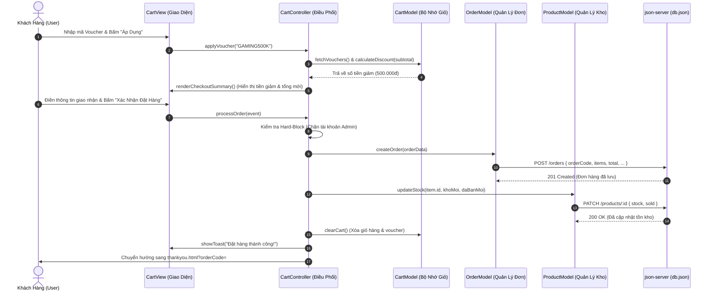

# SƠ ĐỒ VÀ TÀI LIỆU KIẾN TRÚC MÔ HÌNH CHUẨN MVC (MODEL - VIEW - CONTROLLER)
## DỰ ÁN: WEBSITE BÁN ĐIỆN THOẠI THÔNG MINH SMARTSTORE
**Môn học:** Lập trình JavaScript Nâng Cao (WEB2062 / Javascript Advanced) - FPT Polytechnic  
**Kiến trúc hệ thống:** Mô hình MVC Chuẩn (Model - View - Controller) kết hợp Đa Trang Độc Lập (Multi-Page Architecture - MPA) & CSS Phân Tầng Chuyên Biệt.

---

## 1. TỔNG QUAN KIẾN TRÚC HỆ THỐNG (SYSTEM OVERVIEW)

Trước đây, dự án được gom trong 1 tệp `index.html` duy nhất (Single Page) gây khó khăn cho việc quản lý mã nguồn, vi phạm nguyên lý phân tách trách nhiệm (Separation of Concerns).  
Hiện tại, dự án đã được cải tiến toàn diện sang **Mô hình Chuẩn MVC** kết hợp **Kiến trúc Đa Trang (Multi-Page Architecture - MPA)**:

```
                          ┌───────────────────────────┐
                          │   NGƯỜI DÙNG (USER/CLIENT)│
                          └─────────────┬─────────────┘
                                        │ (Tương tác: Click, Submit, Search)
                                        ▼
    ┌───────────────────────────────────────────────────────────────────────┐
    │                       CONTROLLER LAYER (ĐIỀU PHỐI)                    │
    │  • AppController.js      : Dual-Mode Router, Khởi tạo ứng dụng        │
    │  • ShopController.js     : Lọc hãng, tìm kiếm, sắp xếp, so sánh       │
    │  • DetailController.js   : Xem 10 thông số, tăng giảm số lượng, mua ngay│
    │  • CartController.js     : Thêm/Sửa/Xóa giỏ, Voucher, Thanh toán, Hóa đơn│
    │  • AuthController.js     : Đăng nhập/ký, Hồ sơ, Hủy đơn, Nhận diện danh tính│
    └──────────────────┬────────────────────────────────────┬───────────────┘
                       │                                    ▲
          (1) Thao tác │                                    │ (4) Kích hoạt
              dữ liệu  │                                    │     render
                       ▼                                    │
    ┌──────────────────────────────────────┐  (3) Dữ liệu   │
    │         MODEL LAYER (DỮ LIỆU)        ├────────────────┤
    │  • ProductModel.js : API /products   │    đã xử lý    │
    │  • CartModel.js    : localStorage    │                │
    │  • OrderModel.js   : API /orders     │                │
    │  • UserModel.js    : API /users      │                │
    └──────────────────┬───────────────────┘                │
                       │                                    │
          (2) Giao tiếp│ RESTful API                        │
              CRUD     ▼                                    │
    ┌──────────────────────────────────────┐                │
    │     BACKEND MOCK (JSON-SERVER)       │                │
    │             db.json                  │                │
    └──────────────────────────────────────┘                │
                                                            ▼
                                           ┌────────────────────────────────┐
                                           │       VIEW LAYER (HIỂN THỊ)    │
                                           │  • BaseView.js    : Toast, Modal│
                                           │  • ProductView.js : Lưới, Specs│
                                           │  • CartView.js    : Giỏ, Voucher│
                                           │  • OrderView.js   : Hóa đơn, Đơn│
                                           │  • UserView.js    : Form, Hồ sơ│
                                           └────────────────┬───────────────┘
                                                            │ (5) Cập nhật DOM
                                                            ▼
                                           ┌────────────────────────────────┐
                                           │     GIAO DIỆN NGƯỜI DÙNG (DOM) │
                                           │    (HTML + CSS Phân Tầng)      │
                                           └────────────────────────────────┘
```

---

## 2. SƠ ĐỒ LUỒNG DỮ LIỆU MERMAID (DATA FLOW SEQUENCE)

### Luồng Đặt Hàng & Xử Lý Voucher (Voucher + Checkout Flow)



---

## 3. BẢN ĐỒ CẤU TRÚC THƯ MỤC VÀ TỆP TIN DỰ ÁN

```
website-gaming-phone/
│
├── index.html                      # TRANG CHỦ: Hero Banner 3D, Cam kết, Top 4 Gaming Phone, Top 8 Bán Chạy
├── shop.html                       # TRANG CỬA HÀNG: Bộ lọc 8 hãng, Tìm kiếm, Lọc giá, Phân trang, Bảng so sánh
├── detail.html                     # TRANG CHI TIẾT: Nạp ?id=..., Bảng 10 thông số chuẩn CellphoneS, Nút Mua Ngay
├── cart.html                       # TRANG GIỎ HÀNG: Bảng tăng giảm số lượng, Gamification Reward Bar quà tặng
├── checkout.html                   # TRANG THANH TOÁN: Form giao nhận, Voucher Chips, Hard-block chặn Admin
├── thankyou.html                   # TRANG CẢM ƠN: Stepper tiến trình, Modal xem trước hóa đơn, Nút In hóa đơn
├── auth.html                       # TRANG ĐĂNG NHẬP/ĐĂNG KÝ: Tab chuyển đổi, Smart Identity Card, Demo Accounts
├── profile.html                    # TRANG HỒ SƠ: Sửa thông tin, Lịch sử mua hàng, Khách tự hủy đơn hoàn kho
├── tracking.html                   # TRANG TRA CỨU: Tra cứu vận đơn bằng Mã đơn hoặc Số điện thoại
├── contact.html                    # TRANG LIÊN HỆ: Giới thiệu cửa hàng, Bản đồ, Giờ mở cửa, Form gửi liên hệ
├── admin.html                      # BẢNG QUẢN TRỊ ADMIN: Thống kê KPI, CRUD Sản phẩm, Quản lý Đơn, Khách hàng
│
├── styles/                         # HỆ THỐNG CSS PHÂN TẦNG CHUYÊN BIỆT
│   ├── base.css                    # Biến màu (CSS Variables), Reset, Navbar, Footer, Buttons, Modals, Toasts
│   ├── user.css                    # Toàn bộ CSS giao diện khách hàng (Cards, Filters, Detail, Cart, Stepper, Print)
│   ├── admin.css                   # Toàn bộ CSS quản trị admin (Admin Navbar, Sidebar, KPI Cards, Admin Tables)
│   └── style.css                   # Master Bundle (@import base.css, user.css, admin.css) bảo đảm tương thích ngược
│
├── js/                             # HỆ THỐNG MÃ NGUỒN MVC (MODEL - VIEW - CONTROLLER)
│   ├── models/                     # TẦNG MODEL: XỬ LÝ DỮ LIỆU & GIAO TIẾP SERVER
│   │   ├── ProductModel.js         # Lấy sản phẩm, lọc theo hãng/giá/từ khóa, phân trang, cập nhật tồn kho, so sánh
│   │   ├── CartModel.js            # Quản lý localStorage giỏ hàng, tính tổng tiền, mã giảm giá, quà tặng Gamification
│   │   ├── OrderModel.js           # Tạo đơn hàng, tra cứu mã đơn/SĐT, lấy đơn cá nhân, hủy đơn hoàn trả tồn kho
│   │   └── UserModel.js            # Đăng nhập, đăng ký, phiên session, sửa thông tin cá nhân, Smart Identity
│   │
│   ├── views/                      # TẦNG VIEW: HIỂN THỊ GIAO DIỆN & TRÌNH BÀY DOM
│   │   ├── BaseView.js             # Toast thông báo, Mở/Đóng Modal an toàn, Định dạng tiền tệ VND, User Navbar
│   │   ├── ProductView.js          # Lưới sản phẩm, Phân trang, Chi tiết 10 thông số, Bảng so sánh 10 tiêu chí
│   │   ├── CartView.js             # Bảng giỏ hàng, Thanh quà tặng Reward Bar, Tóm tắt checkout, Voucher Chips
│   │   ├── OrderView.js            # Màn hình cảm ơn, Hóa đơn bán lẻ kiêm phiếu bảo hành, Lịch sử đơn hàng, Tracking
│   │   └── UserView.js             # Form auth đăng nhập/ký, Form cập nhật hồ sơ, Thẻ Smart Identity Resolution
│   │
│   ├── controllers/                # TẦNG CONTROLLER: ĐIỀU PHỐI LUỒNG & BẮT SỰ KIỆN
│   │   ├── AppController.js        # Controller trung tâm, Khởi tạo ứng dụng, Dual-Mode Router (hỗ trợ SPA & MPA)
│   │   ├── ShopController.js       # Bắt sự kiện lọc hãng, tìm kiếm từ khóa, chọn mức giá, phân trang, thêm vào so sánh
│   │   ├── DetailController.js     # Đọc param ?id=..., nạp chi tiết, tăng/giảm số lượng, xử lý nút Mua Ngay
│   │   ├── CartController.js       # Thêm/sửa/xóa giỏ, Áp dụng voucher, Đặt hàng (chặn admin), Hóa đơn, In ấn
│   │   └── AuthController.js       # Xử lý submit login/register, Đăng xuất, Lưu hồ sơ, Khách hủy đơn an toàn
│   │
│   ├── mvc_app.js                  # BOOTSTRAP APP: Khởi tạo các Controller, Gắn Global Interface bảo toàn tương thích
│   │
│   ├── admin/                      # CÁC MODULE QUẢN TRỊ ADMIN ĐỘC LẬP
│   │   ├── state.js                # State admin, kiểm tra đăng nhập role admin
│   │   ├── products.js             # CRUD sản phẩm, preview ảnh thời gian thực, xóa an toàn
│   │   ├── orders.js               # Đổi trạng thái đơn (có hộp thoại xác nhận), in hóa đơn admin
│   │   ├── customers.js            # Quản lý danh sách khách hàng, khóa/mở tài khoản
│   │   └── main.js                 # Entry point khởi tạo admin dashboard
│   │
│   └── _backup_legacy/             # Thư mục lưu trữ mã nguồn cũ trước khi refactor
│
├── db.json                         # Cơ sở dữ liệu JSON-Server (products, categories, users, orders, vouchers)
├── chay_server.bat                 # Script batch khởi động server an toàn tự động giải phóng port 3000
└── NGUYEN_TAC_BAO_TOAN...md        # Quy tắc bảo toàn tính năng chống hỏng chéo
```

---

## 4. CHI TIẾT TỪNG TẦNG TRONG MÔ HÌNH MVC

### 4.1. Tầng Model (Data & Business Logic)
- **ProductModel.js**:
  - `fetchAllProducts()`: Gọi `GET /products` lấy toàn bộ sản phẩm.
  - `fetchCategories()`: Gọi `GET /categories` lấy 8 thương hiệu.
  - `fetchProductById(id)`: Lấy chi tiết 1 sản phẩm.
  - `updateStock(id, newStock, newSold)`: Gọi `PATCH /products/:id` cập nhật số lượng tồn kho và đã bán khi mua/hủy đơn.
  - `filterProducts(items, filters)`: Thuật toán lọc kết hợp (Thương hiệu + Từ khóa + Khoảng giá + Sắp xếp).
  - `paginate(items, page, pageSize)`: Phân trang danh sách sản phẩm.
  - `addToCompare(id)`: Quản lý danh sách so sánh tối đa 3 máy trong `localStorage`.

- **CartModel.js**:
  - `getItems()`, `saveItems(items)`: Lưu trữ giỏ hàng trong `localStorage` (`smartstore_cart`).
  - `addItem(product, qty)`: Thêm sản phẩm, kiểm tra nghiêm ngặt tồn kho không cho vượt quá số lượng trong kho.
  - `changeQuantity(id, delta)`: Tăng giảm số lượng, tự động cảnh báo khi vượt tồn kho hoặc chạm mốc tối thiểu.
  - `calculateDiscount(subtotal)`: Thuật toán tính số tiền giảm giá đa điều kiện (theo số tiền cố định hoặc theo % có giới hạn `maxDiscount` và điều kiện `minOrder`).
  - `calculateRewardProgress(subtotal)`: Tính toán % tiến trình và mốc quà tặng Gamification Reward Bar (10 triệu: Củ sạc 67W, 20 triệu: Combo Gaming VIP).

- **OrderModel.js**:
  - `createOrder(orderData)`: Gọi `POST /orders` tạo đơn hàng mới.
  - `fetchOrderByCode(code)`: Tra cứu đơn hàng theo mã `#DH...`.
  - `fetchOrdersByUserId(userId)`: Lấy toàn bộ đơn hàng cá nhân của khách hàng.
  - `cancelOrder(orderId)`: Gọi `PATCH /orders/:id` chuyển trạng thái sang `cancelled`, đồng thời hoàn trả lại toàn bộ số lượng tồn kho cho các sản phẩm trong đơn.

- **UserModel.js**:
  - `getCurrentUser()`, `saveUser(user)`, `logout()`: Quản lý phiên làm việc trong `localStorage` (`smartstore_user`).
  - `login(email, password)`: Xác thực thông tin đăng nhập, phân loại vai trò `admin` hoặc `customer`.
  - `register(name, email, password, phone, address)`: Đăng ký tài khoản mới, kiểm tra chống trùng lặp email.
  - `checkIdentityByEmail(email)`: Tính năng Smart Identity Resolution nhận diện danh tính khi nhập email lúc thanh toán.

---

### 4.2. Tầng View (UI Rendering & Presentation)
- **BaseView.js**:
  - `showToast(msg, type)`: Hiển thị thông báo trạng thái nổi góc dưới (`success`, `warning`, `error`, `info`).
  - `openModal(id)`, `closeModal(id)`: Quản lý bật/tắt modal an toàn, tự động khóa cuộn trang (`overflow: hidden`).
  - `formatCurrency(val)`: Chuyển đổi số thành tiền Việt Nam Đồng (ví dụ: `25.990.000 ₫`).
  - `renderNavUser(user)`: Hiển thị Avatar, tên người dùng, Menu Dropdown hồ sơ hoặc nút Đăng nhập.

- **ProductView.js**:
  - `createProductCardHtml(sp)`: Sinh thẻ sản phẩm chuẩn với Spec Chips (RAM, CPU, Pin), huy hiệu Sale/Hot, nút Xem nhanh, So sánh, Thêm giỏ.
  - `renderProductGrid(containerId, products)`: Hiển thị lưới thẻ sản phẩm.
  - `renderPagination(containerId, totalPages, currentPage)`: Hiển thị các nút phân trang (Trước, 1, 2, 3, Sau).
  - `renderProductDetail(containerId, sp)`: Hiển thị chi tiết sản phẩm kèm **Bảng 10 Thông Số Kỹ Thuật Chuẩn CellphoneS**.
  - `renderComparisonTable(containerId, products)`: Hiển thị bảng đối chiếu 10 thông số cạnh nhau giữa tối đa 3 mẫu điện thoại.

- **CartView.js**:
  - `renderCartTable(items, subtotal)`: Render bảng giỏ hàng với nút tăng giảm số lượng, thành tiền từng món.
  - `renderRewardBar(subtotal)`: Render thanh tiến trình quà tặng Gamification với hiệu ứng lấp đầy track màu xanh ngọc.
  - `renderCheckoutSummary(items, subtotal, discount, total, voucher)`: Render tóm tắt chi phí thanh toán.
  - `renderVoucherChips(vouchers, appliedVoucher, subtotal)`: Render danh sách mã giảm giá gợi ý để khách bấm chọn nhanh.

- **OrderView.js**:
  - `renderThankYouView(order)`: Render màn hình đặt hàng thành công kèm Stepper tiến trình 4 giai đoạn.
  - `renderInvoiceModal(modalBodyId, order)`: Render **Hóa Đơn Bán Hàng Kiêm Phiếu Bảo Hành** chuyên nghiệp đầy đủ Quốc hiệu, Mã số thuế, Chi tiết linh kiện, Cam kết bảo hành 12 tháng, Chữ ký xuất kho.
  - `renderUserOrders(containerId, orders)`: Render danh sách đơn hàng cá nhân trong trang Profile với nút Hủy đơn an toàn.
  - `renderTrackingResult(containerId, orders)`: Render kết quả tra cứu tiến trình đơn hàng.

---

### 4.3. Tầng Controller (Event Handling & Coordination)
- **AppController.js**:
  - Khởi tạo tất cả Models.
  - **Dual-Mode Router (`goTo(viewName, params)`)**: Tự động nhận diện nếu trang hiện tại có chứa section đó thì kích hoạt hiển thị nội trang; nếu ở trang khác thì chuyển hướng URL sang `${viewName}.html?param=...`.
  - Quản lý phím nóng toàn cục (`Escape` để đóng modal, click backdrop để đóng).

- **ShopController.js**:
  - Bắt các sự kiện thay đổi trên Form tìm kiếm, Dropdown lọc giá, Dropdown sắp xếp.
  - Điều phối thuật toán lọc của `ProductModel` và gọi `ProductView` cập nhật lại giao diện không cần tải lại toàn bộ trang.

- **DetailController.js**:
  - Đọc `?id=...` từ URL query string.
  - Nạp thông tin sản phẩm và điều phối hiển thị chi tiết.
  - Xử lý hành vi nút **"Mua Ngay"** (Thêm vào giỏ và chuyển thẳng sang màn hình thanh toán Checkout).

- **CartController.js**:
  - Điều phối tăng/giảm số lượng món hàng, xóa sản phẩm, làm sạch giỏ.
  - Xử lý áp dụng voucher, kiểm tra điều kiện đơn tối thiểu.
  - **Xử lý Đặt hàng**: Thực hiện Hard-Block chặn tài khoản Admin mua hàng, sinh mã đơn `#DH...`, lưu đơn lên server, trừ tồn kho và chuyển hướng sang màn hình cảm ơn.
  - Xử lý mở modal xem hóa đơn và kích hoạt lệnh in trực tiếp `window.print()`.
  - Xử lý nút **"Xem Đơn Hàng Của Tôi"** với cơ chế phân luồng thông minh theo trạng thái phiên làm việc.

- **AuthController.js**:
  - Xử lý biểu mẫu Đăng nhập và Đăng ký tài khoản.
  - Xử lý Đăng xuất và dọn dẹp phiên.
  - Xử lý cập nhật thông tin cá nhân.
  - Xử lý sự kiện khách hàng hủy đơn hàng (kèm xác nhận bảo vệ và hoàn trả kho).
  - Xử lý tính năng Smart Identity Resolution (tự động nhận diện tài khoản khi nhập email tại bước thanh toán).

---

## 5. HỆ THỐNG CSS PHÂN TẦNG CHUYÊN BIỆT (MODULAR CSS)

Để đảm bảo hiệu năng và tính mạch lạc, toàn bộ CSS đã được phân tách thành 3 tệp độc lập:

1. **`styles/base.css`** (776 dòng):
   - Chứa hệ thống biến màu CSS Variables (`--primary: #0284c7`, `--secondary: #0f172a`, `--accent: #ef4444`, `--success: #10b981`, ...).
   - Reset CSS, Typography (phông chữ `Plus Jakarta Sans`), Container bố cục.
   - Thanh Header, Chân trang Footer, Menu người dùng, Huy hiệu giỏ hàng.
   - Hệ thống nút bấm chuẩn (`btn-primary`, `btn-secondary`, `btn-danger`, `btn-success`).
   - Khung Modal Hộp thoại mờ (`modal-overlay`, `modal-box`) và Toast thông báo thời gian thực.

2. **`styles/user.css`** (1474 dòng):
   - Banner Hero Công Nghệ 3D, Dải 8 thương hiệu (Brand Pills).
   - Khối Flash Sale Giờ Vàng kèm đồng hồ đếm ngược.
   - Lưới thẻ sản phẩm (Product Card, Specs Chips, Giá tiền, Trạng thái kho).
   - Giao diện Xem Chi Tiết và Bảng 10 thông số chuẩn CellphoneS.
   - Bảng So Sánh Sản Phẩm cạnh nhau và Thanh Ghim So Sánh (Sticky Dock).
   - Bảng Giỏ Hàng, Thanh Tiến Trình Quà Tặng Độc Quyền (Cart Reward Bar).
   - Tóm Tắt Thanh Toán Đơn Hàng và Khối Mã Giảm Giá (Voucher Chips).
   - Stepper Tiến Trình Đơn Hàng và Giao Diện Hóa Đơn Bán Lẻ (hỗ trợ `@media print`).

3. **`styles/admin.css`** (358 dòng):
   - Thanh Navbar quản trị viên Admin (`admin-navbar`).
   - Bố cục Dashboard Quản trị (`admin-layout`, `admin-sidebar`).
   - Thẻ thống kê KPI doanh thu, đơn hàng, sản phẩm, khách hàng.
   - Bảng dữ liệu quản trị CRUD (`data-table`, `badge-status`, `table-responsive`).
   - Form chỉnh sửa sản phẩm 2 cột và các modal quản trị chuyên dụng.

4. **`styles/style.css`** (Bundle Tương Thích Ngược):
   ```css
   @import url('base.css');
   @import url('user.css');
   @import url('admin.css');
   ```
   Tự động tổng hợp cả 3 tệp để đảm bảo các tệp cũ hoặc đường dẫn liên kết dự phòng luôn hoạt động 100%.

---

## 6. KỊCH BẢN HƯỚNG DẪN BẢO VỆ TRƯỚC GIẢNG VIÊN (DEFENSE Q&A)

### Câu hỏi 1: "Tại sao em lại tách dự án ra nhiều tệp HTML và cấu trúc theo mô hình MVC?"
> **Trả lời:**  
> "Thưa thầy/cô, việc gộp toàn bộ giao diện và logic vào một file `index.html` duy nhất tuy nhanh ở giai đoạn đầu nhưng vi phạm nguyên lý **Separation of Concerns (Phân tách trách nhiệm)** và rất khó bảo trì khi dự án mở rộng.  
> Em đã tái cấu trúc dự án sang mô hình chuẩn **MVC (Model - View - Controller)** kết hợp **Kiến trúc Đa Trang (Multi-Page Architecture - MPA)**:  
> - **Model**: Chuyên trách dữ liệu, lưu trữ (`localStorage`) và giao tiếp API với `json-server`.  
> - **View**: Chuyên trách hiển thị DOM, render HTML và định dạng giao diện người dùng.  
> - **Controller**: Đóng vai trò cầu nối trung gian, bắt sự kiện từ người dùng, gọi Model xử lý dữ liệu rồi yêu cầu View cập nhật giao diện.  
> Nhờ đó, mã nguồn có tính module hóa cao, dễ đọc, dễ kiểm thử và hoàn toàn đáp ứng tiêu chuẩn của một ứng dụng Web chuyên nghiệp."

### Câu hỏi 2: "Trong mô hình này, khi người dùng bấm nút 'Đặt Hàng', luồng dữ liệu chạy như thế nào qua các tầng?"
> **Trả lời:**  
> "Thưa thầy/cô, luồng chạy diễn ra tuần tự qua các bước:  
> 1. Người dùng bấm submit trên form thanh toán, sự kiện được bắt bởi **`CartController.processOrder()`**.  
> 2. `CartController` kiểm tra phân quyền (hard-block chặn tài khoản admin đặt hàng), sau đó thu thập dữ liệu giỏ hàng từ **`CartModel`** và thông tin khách hàng.  
> 3. `CartController` gọi **`OrderModel.createOrder()`** để thực hiện `POST /orders` lên `json-server`.  
> 4. Sau khi đơn được tạo, `CartController` gọi **`ProductModel.updateStock()`** để gửi `PATCH /products/:id`, trừ số lượng tồn kho và tăng số lượng đã bán.  
> 5. `CartController` làm sạch giỏ hàng thông qua `CartModel.clearCart()`, gọi **`BaseView.showToast()`** thông báo thành công và chuyển hướng trình duyệt sang `thankyou.html` để **`OrderView`** hiển thị hóa đơn và tiến trình đơn hàng."

### Câu hỏi 3: "Khi người dùng chuyển qua lại giữa các trang HTML độc lập (như từ Shop sang Cart, sang Checkout), làm thế nào để dữ liệu giỏ hàng và phiên đăng nhập không bị mất?"
> **Trả lời:**  
> "Thưa thầy/cô, trong kiến trúc Đa Trang (MPA), khi trang web tải lại, bộ nhớ RAM JavaScript sẽ được làm mới. Để đảm bảo trạng thái toàn vẹn giữa các trang:  
> - Dữ liệu Giỏ Hàng (`smartstore_cart`), Thông tin Người Dùng Đăng Nhập (`smartstore_user`), Danh Sách So Sánh (`smartstore_compare`) và Đơn Hàng Vừa Đặt (`smartstore_recent_order`) được lưu trữ bền vững trong **`localStorage`**.  
> - Dữ liệu Mã Giảm Giá Voucher (`smartstore_voucher`) được lưu trữ theo phiên trong **`sessionStorage`**.  
> - Tham số trang (như ID sản phẩm cần xem chi tiết, mã đơn hàng cần tra cứu) được truyền tải qua **URL Query Parameters** (ví dụ: `detail.html?id=34` hay `thankyou.html?orderCode=#DH...`).  
> Khi bất kỳ trang HTML nào được tải lên, **`AppController.init()`** sẽ tự động đọc lại các kho dữ liệu trên để phục hồi trạng thái một cách hoàn hảo và liền mạch."

---
*Tài liệu được biên soạn và bảo chứng kỹ thuật cho kỳ thi Bảo vệ Assignment môn JavaScript Nâng Cao - FPT Polytechnic.*
